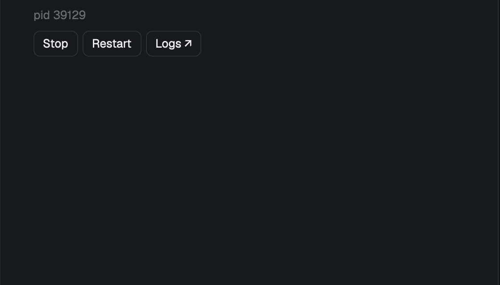

# Pitchfork, a Herdr mod

A panel for the [Herdr](https://herdr.dev) app that shows the [Pitchfork](https://pitchfork.jdx.dev) daemons of the focused worktree, or all of them. Start, stop and restart them one by one or all at once, and follow their logs in a tab.



## Install

You need [Pitchfork](https://pitchfork.jdx.dev) 2.30 or newer on the PATH of the shell Herdr starts. The panel never starts the Pitchfork supervisor by itself; if none is running it offers a button.

```sh
git clone https://github.com/moeriki/herdr-pitchfork.git ~/Projects/herdr-pitchfork
ln -s ~/Projects/herdr-pitchfork/mods/pitchfork ~/.config/herdr-app/mods/pitchfork
```

Herdr docks the panel on the right the first time it sees the folder. To keep it beside Files and Changes instead, add a block to your own layout's panel stack:

```json
{ "id": "pitchfork-panel", "type": "block", "content": { "mod": "pitchfork" } }
```

Optional prop: `"binary": "/absolute/path/to/pitchfork"` when Herdr can't find `pitchfork` on its PATH (used on this machine only).

No keys are bound. Bind `pitchfork.start`, `stop`, `restart`, `logs`, `open`, `next`, `prev` or `refresh` in `keys.json` if you want them; they act on the selected daemon.

[RECIPE.md](RECIPE.md) is the brief to build it from scratch.

## Develop

```sh
herdr-app check ~/.config/herdr-app/mods/pitchfork
node --test tests/*.test.mjs
PITCHFORK_LIVE_TEST=1 node --test tests/model.test.mjs   # starts and stops two throwaway daemons
```

## License

[MIT](LICENSE).
