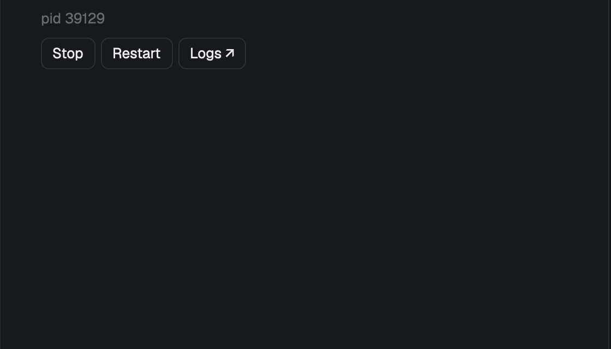

# Pitchfork

A side panel for the [Pitchfork](https://pitchfork.jdx.dev) daemon supervisor. It lists the daemons of the focused worktree, or every daemon on the machine. You can start, stop and restart them, singly or all at once, and open their logs in a tab that follows the output.

## What you see

One card filling its block: rounded 10px, 1px `border`, `background` fill, 13px UI text, the same frame as the shipped Files and Changes panels.

- **Header**, 42px, bottom border: "Pitchfork" semibold. A badge (10px, `muted`, 1px border, radius 4) shows `<running>/<total> running` when there are daemons. On the right is a segmented switch, **Worktree | All**: 22px segments, 11px text, the active one on `raised` in `foreground`, the other `dim`.
- **List**, scrolling, 6px padding. One row per daemon, 10px by 8px padding, radius 7, `selected` fill on the selected row and `hover` on hover:
  - Line 1: a 7px status dot, the daemon's short name (semibold, truncated) and its status on the right (11px), in the same colour as the dot.
  - Line 2 (11px, `dim`, indented 15px): `:port · pid N · oneshot` (whichever are known), then the URL without its scheme, truncated.
  - The daemon's error, if any, in `blocked`.
  - Buttons (24px, radius 6, 11px): **Start**, filled `solid`; or **Stop** and **Restart**, outlined. Then **Logs ↗**, and **Open ↗** while the daemon runs and has a URL: its proxy URL, else `http://localhost:<active_port>` (labelled "Remote URL" on another machine).
- **Namespace headers**, shown in All view or when there is more than one namespace: the namespace in 13px semibold `foreground`, with a `running/total` badge that is `done` when anything runs and `muted` otherwise. Every header after the first has a 1px top border, so the groups read as blocks.
- **Footer**, Worktree view only, top border, 10px padding: **Start all** (filled), **Restart all** and **Stop all**, each shown only when it applies. The footer hides when none apply.
- Empty and info states in the list, 12px `dim`: "Reading Pitchfork…", "No daemons configured.", "No Pitchfork daemons for this folder. Switch to All to see every daemon.", "Select a space with a working folder.", and "Pitchfork's supervisor isn't running." with a filled **Start supervisor** button. Real failures are in `blocked`, including "Could not run pitchfork…" when the binary is missing.

## How it behaves

- **Context:** Worktree view runs `pitchfork list --json --project` in the focused terminal's folder (else the space's folder); Pitchfork resolves the project itself, including `.config/pitchfork.toml`, `pitchfork.local.toml` and registered external configs. All view runs `pitchfork list --json` from the machine's home. Spaces on another machine run everything there.
- **Supervisor:** polls run with `PITCHFORK_SUPERVISOR_AUTO_START=false`, so opening the panel never spawns a supervisor with Herdr's environment. When none is running, the panel says so and offers Start supervisor (`pitchfork supervisor start`).
- **Polling:** every 2.5s, and right after every action. Changing space, folder or view clears the list at once, so it never shows another worktree's daemons.
- **Statuses:** `running` is `done` coloured; `failed`/`errored` are `blocked`; everything else (`stopped`, `available`, `completed`, `waiting`, …) is `dim`. While a command the panel sent is in flight, that row shows `starting…` / `stopping…` / `restarting…` in `accent`, and its dot pulses (opacity 0.3→1, 900ms). Only that row's lifecycle buttons hide; other daemons stay usable, so several can start at once.
- **Actions:** these run on the first click, with no confirmation. Before each mutation the panel re-reads Pitchfork. Start does nothing if the daemon is already running, and re-runs a completed oneshot. `waiting`, `restarting` and `errored` (possibly between retries) offer Stop, which is how Pitchfork interrupts them; `stopping` offers nothing; disabled daemons only Stop. Start waits for Pitchfork's ready checks, so lifecycle commands get a 10-minute `exec` timeout. The toast says the command finished, or says what went wrong.
- **Group actions:** these act on the listed daemons. Restart all only touches running ones. They're unavailable while any listed daemon is transitioning. One `pitchfork <action> -- <ids…>` call.
- **Logs ↗:** opens a tab named `logs · <name>` in the space, in the project folder, running `pitchfork logs -n 200 --tail -- <id>`. If that tab is already open, it switches to it. Closing the tab ends the tail, not the daemon.
- **Open ↗:** opens the URL with `open`, falling back to `xdg-open`. For a remote daemon it shows the URL instead. It's hidden for stopped daemons because opening a stopped daemon's proxy URL makes Pitchfork start it.
- **Clicking a row** selects it. The selection is what key commands act on.
- **Keys:** none are bound. `keys.json` can bind `pitchfork.start`, `stop`, `restart`, `logs`, `open`, `next`, `prev` and `refresh`; these reach shown copies only.
- Closing the panel, changing space or quitting Herdr never stops daemons.

## Built from

- `mods/pitchfork/`: `main.js` (the view), `model.js` (pure Pitchfork adapter: JSON decode, per-action `disposition`, `daemonActions`, `groupActions`, `daemonUrl`, `control`, `controlGroup`), `pitchfork.svg` (an icon for a layout's own toggle button).
- `mod.json` `{"place":"right","size":360}`: Herdr docks it on the right the first time it sees the folder. A layout can instead place it as a block, e.g. in the right-hand panel stack beside `files` and `changes`. Props: `binary` (optional absolute path to `pitchfork`, used only locally).
- `herdr`: `focused`, `spaces`, `theme`, `exec` (with `on: space.machine`), `hc`, `home`, `props`, `notify`, `nextCommand`, `run` (`tab.select`, `tab.rename`).
- **Log tabs:** `hc run --bg --no-parent --cwd <root> [--on <machine>] --label herdr.space=<space> --label herdr.tab=pflogs-<space tail>-<id> --label pitchfork.logs=<id> -- pitchfork logs …`. Herdr adopts a terminal labelled with an unknown tab id as a new tab under exactly that id, so the id is how the panel finds the tab again.
- **Programs run:** `pitchfork` (through `env` for polls), `sh` (remote `$HOME` only), `hc`, `open` / `xdg-open`.

## Watch out

- `run()` returns null, so the panel can't learn the terminal or tab that `tab.new` made. Choose the tab id yourself through `hc run` labels instead.
- Remote ids carry a `<machine>/` prefix. Strip it for `herdr.space`, and add it back when looking up or selecting the tab.
- Keep the per-daemon pending state as a map keyed by id. A single busy flag blocks every row.
- Don't cancel an in-flight action when the selection changes; only cancel it when the space or worktree does.
- Don't walk up to find `pitchfork.toml` yourself: Pitchfork merges config files from the root down and knows names and registered configs you'd miss. `--project` from the focused folder is the truth.
- `pitchfork list` starts a supervisor by default (`supervisor.auto_start`). A panel polling every 2.5s would spawn one from Herdr's environment, so disable it per call.
- The real statuses are `running`, `stopped`, `waiting`, `stopping`, `restarting`, `failed`, `errored`, `completed`, plus a synthetic `available`; there is no `starting`. Daemon ids have exactly one `/`.
- URLs exist only with Pitchfork's proxy enabled, which is off by default; fall back to `active_port`.
- Start can bring up dependencies (`depends`) the panel doesn't list, and Stop all stops the listed ids, not in reverse dependency order.
- A command timeout can leave a start running in Pitchfork. Status is the truth, not the exit code.
- This mod only draws the panel. A toggle button in a tab bar is the layout's job.
- Needs pitchfork 2.30 or newer (`list --json --project`, `restarting`). Remote machines need `pitchfork` and `env` on that machine's exec PATH. Remote use is untested.

## Done when

- In a worktree with `pitchfork.toml`, the panel lists its daemons and the header badge counts the running ones.
- Clicking Start on two stopped daemons in a row shows `starting…` on both, then `running`.
- Restart all and Stop all appear in the footer in Worktree view and are absent in All view.
- All view groups daemons under namespace headers with a `running/total` badge.
- Logs ↗ opens a `logs · <name>` tab that follows the output; clicking it again switches to that tab instead of opening a second one.
- A folder without Pitchfork config shows the hint in `dim`, not red.
- With no supervisor running, the panel doesn't start one by itself, and Start supervisor does.
- `herdr-app check mods/pitchfork` passes.
